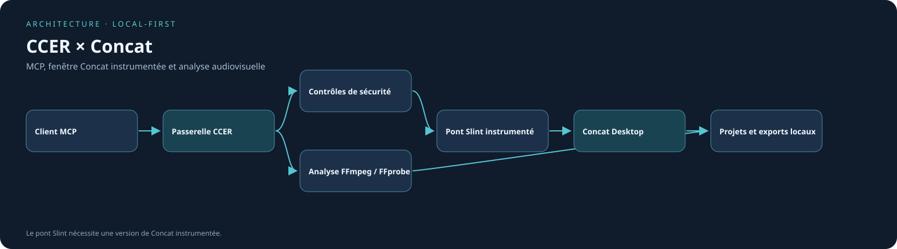

# CCER — Creative Engineering Runtime

<p align="center"><strong>Passerelle MCP pour Concat Desktop · Montage contrôlé, preuves visuelles et analyse audiovisuelle locale.</strong></p>

<p align="center"><a href="https://www.python.org/"></a> <a href="https://modelcontextprotocol.io/"></a> <a href="https://github.com/jub0t/Concat"></a> </p>

**CCER** relie les clients MCP à [Concat Desktop](https://github.com/jub0t/Concat). Il utilise des contrôles locaux, FFmpeg/FFprobe et, avec Concat instrumenté, des captures et gestes vérifiés dans la fenêtre native.

> [!IMPORTANT]
> **CCER et Concat sont complémentaires mais indépendants.** La release officielle permet le MCP standard. Le contrôle visuel natif requiert un **Concat instrumenté avec pont Slint**. Aucun téléchargement ou redémarrage automatique n'est effectué au lancement.

## Sommaire

- [Vision](#vision)
- [Fonctionnalités](#fonctionnalités)
- [Prérequis et installation](#prérequis-et-installation)
- [Architecture](#architecture)
- [Configuration MCP](#client-configuration)
- [Tests et sécurité](#tests-et-sécurité)
- [Licence](#license)

## Vision

**Automatiser sans intervenir à l'aveugle.** CCER vise un contrôle du montage observable, vérifiable et non destructif, tout en préservant les médias originaux. Les contrôles techniques ne remplacent pas une appréciation créative.

## Fonctionnalités

| Domaine | Capacités | Précision |
| --- | --- | --- |
| MCP | Outils natifs de Concat et analyses CCER | Le mode standard peut utiliser un processus distinct |
| Bureau visible | Captures et gestes natifs Slint | Nécessite Concat instrumenté |
| Média | FFmpeg, FFprobe, timecodes, images et audio | Analyse technique, pas vision autonome |
| Sûreté | Autorisations, périmètres, avant/après, timeouts | Pas de rejeu aveugle d'une action incertaine |

**RÈGLE PERMANENTE POUR CHATGPT : montage visuel manuel obligatoire.**
Chaque action modifiant Concat exige une capture avant, un geste réel souris/clavier,
puis une capture après. Aucune mutation headless n'est permise via le connecteur.
Voir [CCER GUI-FIRST](docs/CCER_GUI_FIRST_CONTRACT.md) et
[isolation focus/souris](docs/CCER_FOCUS_ISOLATION.md).
**Aucune action CCER n'est autorisée sur le focus ou le pointeur du bureau
humain.** Le rendu Concat dans un Xvfb isolé reste bloqué par Vulkan/DRI3.

A guarded, **local-first** MCP gateway for **Concat Desktop** on Linux, macOS and Windows.

## Implemented

- Dynamically exposes every native Concat MCP tool (42 in the tested Concat 0.2.8).
- Adds 43 CCER tools: governed editing, creative planning, local audio/video inspection, subtitle preparation, offline English speech, directed rendering, and complete studio production: preflight, project inspection, checkpoints, rollback, timeline QA, transactional batch editing, media probe, audio QA, export QA, mission status, safe recovery and tamper-evident audit.
- Uses the **same native Concat engine** over MCP stdio; does not attempt to edit Concat's open on-screen project (upstream v0.2.8 constraint).
- Explicit `window` or `headless` mode, no silent fallback, sandboxed write paths, bounded subprocess waits.
- No Python runtime dependencies beyond the standard library. FFmpeg and FFprobe are optional for media QA.

## Prérequis et installation

| Composant | Exigence |
| --- | --- |
| Python | 3.10+ avec `venv` |
| Git | Récupération du dépôt |
| Concat Desktop | [Releases officielles](https://github.com/jub0t/Concat/releases/latest) |
| FFmpeg et FFprobe | Contrôles audio/vidéo |

```bash
sudo apt update
sudo apt install -y git python3 python3-venv ffmpeg
git clone https://github.com/jackjosias/ccer-mcp.git
cd ccer-mcp
python3 -m venv .venv
source .venv/bin/activate
python -m pip install -r requirements.txt
python -m pip install -e .
ccer-concat --check
ccer-concat --install
ccer-concat --status
```

Le [`requirements.txt`](requirements.txt) indique qu'aucune dépendance Python tierce n'est obligatoire. Concat et FFmpeg sont installés séparément. L'AppImage est vérifiée par SHA-256, sans mise à jour silencieuse.

## Architecture



[Source Mermaid](docs/architecture.mmd) · [SVG versionné](docs/architecture.svg). Régénération déterministe :

```bash
python3 docs/render_architecture.py --write
python3 docs/render_architecture.py --check
```

## Tests et sécurité

```bash
python3 -m unittest discover -s tests -p 'test_*.py' -q
python3 docs/render_architecture.py --check
```

> [!CAUTION]
> Ne publiez jamais les fichiers `.env`, les clés API, `automation.json`, les vidéos personnelles ou des chemins locaux nominatifs. `git config user.name` et `git config user.email` se configurent uniquement sur votre ordinateur.

## CCER + Concat: install both

**[Concat](https://github.com/jub0t/Concat)** is the upstream, open-source video editor (AGPL-3.0-or-later). **CCER** is an independent MCP integration and does **not** bundle or claim ownership of Concat. Both programs are needed. See the [official releases](https://github.com/jub0t/Concat/releases/latest) and [installation guide](https://concat.standalones.org/guides/install/).

### Ubuntu / Linux (x86_64 or aarch64)

```bash
sudo apt update
sudo apt install -y python3 python3-venv ffmpeg
git clone https://github.com/jackjosias/ccer-mcp.git
cd ccer-mcp
python3 -m venv .venv
. .venv/bin/activate
python -m pip install -e .
ccer-concat --check      # latest official version; no writes
ccer-concat --install    # install or update signed-by-checksum official AppImage
ccer-concat --status     # find installed executable, without network
```

The installer chooses the latest *official stable* GitHub release for Linux and your CPU architecture (latest verified: `v0.2.8` on 30 October 2026), checks the GitHub SHA-256 digest and file size, and installs under `~/.local/share/ccer/concat/`. `--install` is **explicit and idempotent**. Neither `--check` nor MCP startup downloads or changes software. A running Concat process or a manually installed / instrumented Concat binary is **never closed, overwritten or restarted** by the installer.

On Windows or macOS, install [Concat from upstream](https://github.com/jub0t/Concat/releases/latest), and configure `CCER_CONCAT_BIN` with its absolute executable path. On Linux, an existing executable can be selected with `export CCER_CONCAT_BIN=/absolute/path/to/concat`; this overrides the managed AppImage.

### Standard MCP versus CCER native GUI

- **Official Concat / standard MCP:** enable **Settings → Automation → Scripts and apps** and launch `ccer-mcp --mode window`. This uses Concat's own MCP engine, which does *not* control an already-open timeline in Concat's desktop window.
- **Live GUI control via Slint:** `ccer-direct-mcp --access control` requires a **CCER-instrumented Concat build**. The official AppImage does *not* contain CCER's private authenticated Slint bridge. See [Native Slint](docs/CCER_NATIVE_SLINT.md) and [Visible Desktop](docs/CCER_VISIBLE_DESKTOP.md) before setting `CCER_CONCAT_BIN` to your custom build. The direct mode does not launch a second editor.
- **Version updates:** `ccer-concat --check` checks GitHub without downloading; `ccer-concat --install` explicitly installs the verified official latest version. For a patched build, apply the documented patches to a compatible source release only; never hot-swap a running patched editor.

## MCP client configuration

After Linux setup, use this standard MCP example (replace the absolute path with your own checkout):

```json
{
  "mcpServers": {
    "ccer": {
      "command": "/absolute/path/to/ccer-mcp/.venv/bin/ccer-mcp",
      "args": ["--mode", "window"]
    }
  }
}
```

Or run `python -m ccer --concat-bin /absolute/path/to/concat --mode window`. CCER reports an actionable error if the selected executable does not exist. The gateway's `--root` scopes writes to a dedicated media folder (default `~/Videos/CCER`); do not paste Concat automation tokens into configs or Git.

## Production workflow — developer-only native Gateway

Ces appels automatiques sont conservés pour les tests internes. Ils sont
**interdits dans le connecteur ChatGPT Direct**, même en mode control. Toute
mission vidéo de l'utilisateur doit passer par la fenêtre Concat visible.


1. Call `ccer_preflight` and inspect versions and disk capacity.
2. Use `project_create` then `timeline_read` on a **CCER-owned** project.
3. Use `media_probe`, `media_import`, `clip_add`, `title_add`, `captions_add`, effects/keyframes and `edit_apply`.
4. `ccer_checkpoint_create` before disruptive edits; `ccer_batch_edit` wraps commands into Concat's native atomic batch.
5. `ccer_timeline_validate`; inspect `preview_frame`.
6. `project_save`, `export_start`, `export_wait`, `ccer_export_verify`. For a complete recipe, call `ccer_produce` with `name`, `shots`, `profile`, optional `captions`, `titles`, `music`, and `export`.
7. Call `ccer_caption_validate` for readability, `ccer_visual_scan` for black/frozen frames and `ccer_delivery_transcode` for verified square, vertical or landscape deliveries.
8. Use `ccer_audit_report` to check the local journal chain.

### Safety contract

- `ccer_checkpoint_restore` requires `confirm=true`, validates checkpoint SHA, and **refuses any existing concat.lock**. Close the project in every window and API session first. The displaced project stays in an explicit restore-backup folder.
- Timeouts report **UNKNOWN outcome**, never automatically replay potentially destructive edits.
- `ccer_mission_recover` provides guidance, not an unsafe blind retry.
- Native tool argument fields `path`, `location` and `output` must remain under CCER_ROOT. A read-only `file` media input is not currently sandboxed; it may be outside the root.
- The SHA-linked audit detects accidental or partial edits but is **not a cryptographically authenticated record**: an attacker with filesystem write access could replace the entire journal.
- Media QA is diagnostic, not proof of artistic quality; human creative review remains valuable.

## Testing

    python3 -m compileall -q ccer
    python3 -m unittest discover -s tests -v

## Creative studio V2

Documentation détaillée : [CCER V2 Studio](docs/CCER_V2_STUDIO.md).

New MCP tools: `ccer_voice_flite` (English-only offline FFmpeg speech) and
`ccer_studio_produce` (reviewable script/storyboard, optional real narration,
music ducking, frame-timed rendering, SRT subtitles and technical QA).
Start with `ccer_tts_status` to verify whether `ffmpeg-flite` is available.

For French, use a prerecorded French narration through `narrationFile`.
Do not pretend English `flite` can narrate French naturally. Audio/text alignment
is currently estimated, not forced-aligned to speech. The studio renderer uses
FFmpeg as a complementary engine; Concat Desktop stays accessible through MCP.

## Rhythm and subtitle timing (75 MCP tools total)

- `ccer_silence_map`: find quiet/nonquiet passages with FFmpeg.
- `ccer_beat_candidates`: identify rhythmic audio impulses, tentative BPM and confidence.
- `ccer_cut_plan`: propose shot boundaries near supplied impulses. This changes **no project**.
- `ccer_caption_timing_hint`: allocate supplied phrases to nonsilent intervals. This is
  **not** a transcript, word-level alignment, or a substitute for listening review.

The tested workflow uses `ccer_cut_plan` to construct a reviewed storyboard,
then reuses `ccer_directed_render` to output an isolated MP4.

`python3 -m tests.live_rhythm` certifies these steps on a synthetic 120 BPM audio
track under `~/Videos/CCER`, never on a user's existing production project.

## Visual editing and verification (78 MCP tools total)

- `ccer_color_report`: sampled FFmpeg signalstats luminance, saturation and U/V metrics.
- `ccer_reframe_export`: padded "contain" or non-distorting "cover" crop with focus.
- `ccer_transition_export`: new two-clip MP4 with a fade, wipe or slide.
  Original source audio is **not** mixed by this function; optional external soundtrack only.
- `python3 -m tests.live_visual` generates two isolated colored videos, exports
  a vertical crop and a crossfade, and verifies the resulting MP4 files.
- Every rendering tool rejects output overwrites and verifies delivered duration
  and frame dimensions. These controls are not a substitute for artistic review.

## Media intelligence (82 MCP tools total)

- Human-annotated footage catalog with optional existing FFmpeg scene cuts.
- Keyword search across editor-provided descriptions and tags, with provenance.
- Match script storyboard scenes to annotated source clips (including mediaStart).
- Execute approved matching via existing CCER renderer and export QA.

This is metadata/annotation-based retrieval, NOT trained automatic visual recognition.
Detailed guide: docs/CCER_MEDIA_INTELLIGENCE.md.
Reproducible live test: python3 -m tests.live_media_catalog

## Direct Concat Desktop GUI control (85 MCP tools)

ChatGPT GPT-6 can orchestrate the existing CCER editor plus a Concat-specific
X11 visual bridge without any local LLM. Three tools are implemented:
`ccer_desktop_status`, `ccer_desktop_capture` (MCP JPEG image content), and
`ccer_desktop_act` (approved scoped click/key/type/scroll and post-action screenshot).
The window must be verified by exact class/PID, all actions must carry a fresh
window ID and `confirm=true`; this integration is **X11-only**.
Detailed instructions and safeguards: [CCER Desktop Control](docs/CCER_DESKTOP_CONTROL.md).
Live acceptance: `python3 -m tests.live_direct_control`.
Le glisser-déposer est limité au pointeur d'un Xvfb privé attesté ;
il ne doit jamais déplacer la souris physique de l'utilisateur.
Le dialogue GTK « Importer des médias » est pris en charge après vérification
stricte de sa classe, de son titre et de son processus (aucune autre fenêtre).

## Direct ChatGPT MCP connectivity (independent of WCER)

The standalone entrypoint `ccer_direct_stdio.py` serves the existing CCER
MCP gateway over stdio for the official OpenAI `tunnel-client`.

- `observe` (default) exposes 34 review and inspection tools, including
  real Concat screenshots. Writing commands are rejected server-side.
- `control` : l'accès direct ChatGPT est **GUI-FIRST** : outils de lecture
  et `ccer_desktop_act` seulement. Toutes les mutations MCP invisibles sont
  refusées au niveau du serveur. Une capture avant/après chaque geste est
  obligatoire. Le moteur natif conserve ses 85 outils pour les tests internes.
- `python3 -m ccer.tunnel_setup --tunnel-id <real-tunnel-id>` creates a
  separate CCER profile with **no API credentials in Git**.
- `tunnel-client doctor --profile ccer-direct` and
  `tunnel-client run --profile ccer-direct` authenticate that profile.

For an **existing** observe tunnel, use `python3 -m ccer.profile_access --access control --apply`, then restart only the `ccer-direct` process in its original terminal and refresh ChatGPT's connector. Do not recreate the tunnel or disclose secrets.

See [CCER Direct setup](docs/CCER_DIRECT_TUNNEL.md). Verify locally with
`python3 -m tests.live_direct_stdio` (observe) and
`python3 -m tests.live_direct_control` (full control).
The remote ChatGPT app must still be registered and authorized before any
claim of direct ChatGPT operation.

## Scope and roadmap

This is **v0.1.0 foundation**, not an end-to-end self-directed production agent. Automatic understanding of all desktop UI states, full color-grading intelligence, LLM-based creative direction, b-roll discovery, robust beat tracking for varied real-world music, speech forced-alignment, visual continuity understanding and distributed rendering remain subsequent features. Deterministic storyboarding, English flite voice and studio orchestration are implemented. Upstream Concat also limits what's currently possible. No claim of complete CapCut functional parity is made.

## License

This CCER gateway is original code. Concat is a separate upstream project under AGPL-3.0-or-later; its license applies to modifications or redistribution of that upstream as required by the license.
