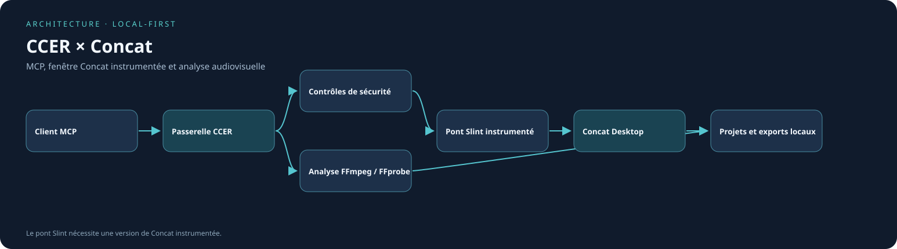
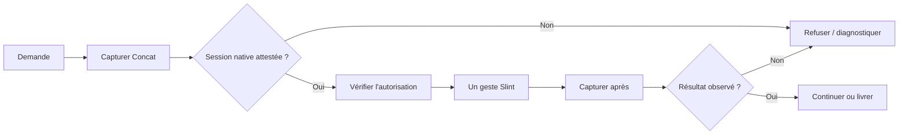
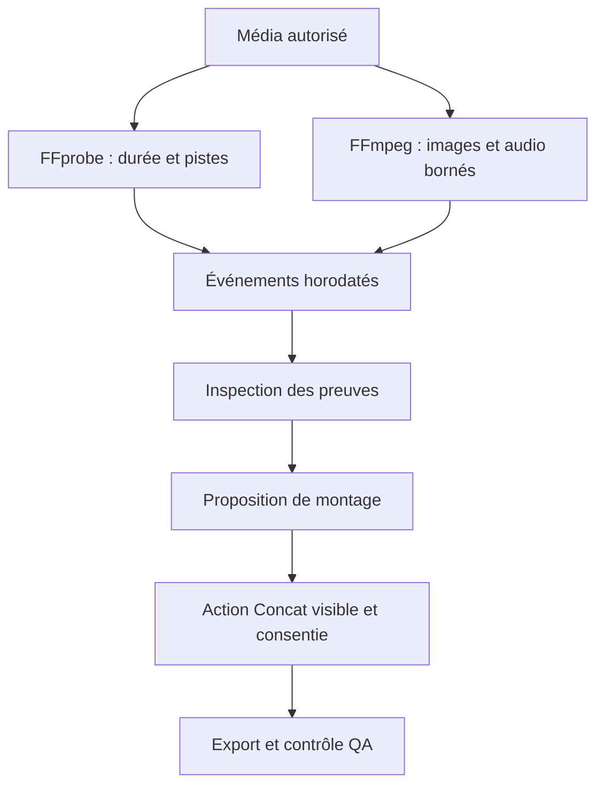

<div align="center">

# CCER
### Creative Engineering Runtime

**ChatGPT ↔ MCP ↔ Concat Desktop.** Montage vidéo observable, inspection audiovisuelle locale, gestes autorisés et vérification des résultats.


[](https://m8ven.ai/mcp/jackjosias-ccer-mcp-1xlke2?s=readme)

**[📒 CHANGELOG — historique chronologique des fonctionnalités, incidents et corrections](CHANGELOG.md)**

[Vision](#vision) · [Diagrammes](#diagrammes) · [Fonctionnement](#fonctionnement) · [Architecture](#architecture) · [Installation](#installation) · [Intelligence A/V](#intelligence-av) · [Sécurité](#securite) · [Documentation](#documentation)

</div>

### Documentation du projet — accès direct

| [README](README.md) | **[📒 CHANGELOG](CHANGELOG.md)** | [Code de conduite](CODE_OF_CONDUCT.md) | [Contribuer](CONTRIBUTING.md) | [Sécurité](SECURITY.md) |
|:---:|:---:|:---:|:---:|:---:|
| Vision, fonctionnement, installation | Historique vérifié, récent en premier | Règles communautaires | Git, tests, PR | Permissions et protection des médias |

> [!IMPORTANT]
> **CCER et Concat sont indépendants.** [Concat Desktop](https://github.com/jub0t/Concat) est l'éditeur vidéo en amont. La passerelle MCP standard ne contrôle **pas automatiquement** la timeline déjà ouverte dans la fenêtre de l'utilisateur. Le contrôle direct d'une fenêtre Concat exige une **version instrumentée avec pont Slint** et une session authentifiée.

---

<a id="vision"></a>
## Vision

**Observer → comprendre → autoriser → agir → vérifier.**

CCER (*Creative Engineering Runtime*) relie un client compatible [Model Context Protocol](https://modelcontextprotocol.io/) à Concat Desktop. Il vise une assistance au montage **visible et vérifiable**, sans agir sur les rushs originaux ni prendre le contrôle du bureau humain à l'insu de son propriétaire.

| Domaine | Capacité | Limite |
|---|---|---|
| **MCP** | Outils Concat et modules CCER | Dépend du binaire et du profil d'accès |
| **Vidéo** | FFmpeg/FFprobe, images horodatées et événements | Pas de vision continue exhaustive garantie |
| **Audio** | Pistes, silences, niveaux, impulsions | Indices techniques, non jugement artistique |
| **Whisper / SRT** | Vérification du modèle intégré, analyses de sous-titres | Modèle présent ≠ transcription exécutée |
| **Bureau visible** | Captures, gestes Slint et preuves avant/après | Build Concat instrumenté requis |
| **Production** | Préparation, outils de rendu et QA | Mutation invisible interdite dans ChatGPT Direct |
| **Sûreté** | Consentement, chemins bornés, audit et rétention | Résultat incertain ≠ action annulée |

**Statut :** package Python `0.1.0` ([`pyproject.toml`](pyproject.toml)), en développement. CCER ne revendique **ni la parité complète avec CapCut ni l'autonomie d'un monteur humain**. Pour les résultats datés, voir le [CHANGELOG](CHANGELOG.md).

<a id="diagrammes"></a>
## Atlas visuel des diagrammes

À la différence de WCER, le dépôt CCER versionne actuellement **un schéma d'architecture** (source Mermaid + SVG). Deux flux complémentaires sont dessinés directement dans ce README ; aucun autre SVG n'est présenté comme déjà disponible.

| Sujet | Accès | Explication |
|---|---|---|
| Architecture globale | [SVG](docs/architecture.svg) · [source Mermaid](docs/architecture.mmd) | Modules, passerelle MCP et Concat |
| Contrôle de la fenêtre | [Flux GUI-FIRST](#fonctionnement) | Permission et preuve de l'action |
| Intelligence média | [Flux A/V](#intelligence-av) | Décodage, analyse et contrôle du rendu |

Index détaillé : [docs/README.md](docs/README.md).

<a id="architecture"></a>
## Architecture



*Diagramme versionné : [architecture.mmd](docs/architecture.mmd).*

```text
Client MCP (ChatGPT ou autre)
  │
  ├─ ccer-mcp (standard) ──────────> moteur MCP Concat distinct
  │
  └─ ccer-direct-mcp ──────────────> DirectGateway
                                      ├─ observer / capturer la fenêtre Slint
                                      ├─ vérifier session + consentement
                                      └─ geste natif → image après action

CCER lecture / QA ────> FFmpeg / FFprobe
                       ├─ images et événements horodatés
                       └─ audio, SRT, plans et vérification des exports
```

### Organisation des sources

| Modules | Responsabilité |
|---|---|
| `ccer/cli.py`, `ccer/server.py`, `ccer/transport.py` | CLI et protocole MCP standard |
| `ccer/direct_cli.py`, `ccer/direct_gateway.py` | Mode Direct et garde-fous |
| `ccer/inapp_protocol.py`, `ccer/native_desktop.py` | Attestation, captures et gestes Slint |
| `ccer/desktop_gui.py`, `ccer/focus_isolation.py` | Observation graphique et non-interférence |
| `ccer/production.py`, `ccer/studio_pipeline.py` | Workflows de production et QA |
| `ccer/timecoded_review.py`, `ccer/av_event_cursor.py` | Preuves temporelles A/V |
| `ccer/av_replay_poll.py`, `ccer/audio_evidence.py` | Lecture bornée et indices audio |
| `ccer/asr_readiness.py`, `ccer/av_timeline.py` | Whisper intégré, transcriptions/SRT |
| `ccer/controls.py`, `ccer/evidence_retention.py` | Sécurité, audit et rétention |

**Nombre d'outils :** consulter le catalogue réel du serveur MCP, pas les anciens décomptes incrémentés au fil du développement.

<a id="fonctionnement"></a>
## Fonctionnement : de la capture à la vérification



**MCP standard :** expose un moteur Concat accessible par MCP et des outils CCER. Il peut utiliser un processus **distinct** de l'éditeur personnel.

**MCP Direct GUI-FIRST :** n'agit que sur une session instrumentée attestée, capture une image **AVANT** chaque geste, exécute une action autorisée, puis inspecte l'image **APRÈS**. `observe` est en lecture seule ; `control` reste strictement GUI-FIRST.

| Étape | Contrôle |
|---|---|
| Préflight | Processus, fenêtre, capabilities et authentification |
| Observation | Image réelle récente, identifiant de fenêtre et reçu |
| Consentement | Confirmation explicite si requise |
| Action | Une interaction native, sans souris physique |
| Vérification | Capture après et résultat indépendant |
| Erreur / timeout | Arrêt, inspection, jamais rejeu aveugle |

Contrats : [GUI-FIRST](docs/CCER_GUI_FIRST_CONTRACT.md), [pont Slint](docs/CCER_NATIVE_SLINT.md), [bureau visible](docs/CCER_VISIBLE_DESKTOP.md), [focus](docs/CCER_FOCUS_ISOLATION.md).

<a id="installation"></a>
## Installation

### Prérequis

| Outil | Requis pour |
|---|---|
| **Python 3.10+**, `venv`, Git | Installer et exécuter CCER |
| **Concat Desktop** | Éditeur vidéo distinct de la passerelle |
| **FFmpeg / FFprobe** | Inspection audio/vidéo et vérification |
| **Rust, Cargo, bibliothèques natives** | Compiler Concat instrumenté |
| **Session graphique Linux compatible** | Pont Slint natif actuel |
| **Client MCP** | Envoyer les commandes au serveur stdio |

**[`requirements.txt`](requirements.txt)** est présent et volontairement minimal : **aucune dépendance pip tierce obligatoire**. Concat, FFmpeg et Rust sont des prérequis système distincts.

### Ubuntu / Linux — installation de CCER

```bash
sudo apt update
sudo apt install -y git python3 python3-venv ffmpeg

git clone https://github.com/jackjosias/ccer-mcp.git
cd ccer-mcp
python3 -m venv .venv
source .venv/bin/activate
python -m pip install -r requirements.txt
python -m pip install -e .
```

Le package expose `ccer-mcp`, `ccer-concat`, `ccer-native`, `ccer-direct-mcp` et `ccer-tunnel-setup`. **Cela n'installe pas automatiquement Concat.**

### Concat officiel (Linux)

```bash
ccer-concat --check
ccer-concat --install   # installation explicite
ccer-concat --status
```

L'installation vérifie le téléchargement par SHA-256 ; **une somme de contrôle n'est pas une signature d'éditeur**. Ne pas substituer silencieusement un nouveau binaire au Concat en cours d'exécution.

Pour réutiliser un binaire existant :

```bash
export CCER_CONCAT_BIN=/chemin/absolu/vers/concat
```

Sur **macOS/Windows**, installer [Concat officiellement](https://github.com/jub0t/Concat/releases/latest) et utiliser le chemin du binaire approprié ; le flux AppImage n'est pas multiplateforme.

### Configuration du client MCP

```json
{
  "mcpServers": {
    "ccer": {
      "command": "/chemin/absolu/ccer-mcp/.venv/bin/ccer-mcp",
      "args": ["--mode", "window"]
    }
  }
}
```

Concat peut nécessiter **Settings → Automation → Scripts and apps**. `ccer-mcp` parle **MCP sur stdio** et attend les requêtes d'un client.

### Choisir le mode

| Mode | Commande | Portée |
|---|---|---|
| Standard graphique | `ccer-mcp --mode window` | Processus Concat MCP distinct |
| Standard isolé | `ccer-mcp --mode headless` | Tests internes explicitement isolés |
| Direct observation | `ccer-direct-mcp --access observe` | Lecture seule, captures |
| Direct contrôle | `ccer-direct-mcp --access control` | Gestes GUI-FIRST sur Concat instrumenté |

Options : `--concat-bin` pour l'exécutable, `--root` pour la racine de médias (défaut `~/Videos/CCER`), `--mode` pour le standard, `--access` pour Direct.

### Compiler le pont Rust/Slint

L'AppImage Concat officielle **n'inclut pas** le pont CCER. Pour préparer le binaire instrumenté :

```bash
ccer-native --check
ccer-native --prepare --fetch   # téléchargement explicite
ccer-native --verify
ccer-native --build             # compilation Cargo explicite
```

Le guide permet aussi de réutiliser un clone amont propre. Ne pas écraser ni remplacer à chaud Concat et ses projets. [Guide complet](docs/CCER_NATIVE_SETUP.md).

> [!WARNING]
> Un build réussi ou un test de protocole Python **ne prouve pas** la réussite d'un montage visible : la validation finale exige une interaction native observée, la non-interférence et un export réel.

### ChatGPT Direct via tunnel

Le profil `tunnel-client` est distinct de la passerelle standard. Un tunnel réel, une authentification et une autorisation côté client sont nécessaires. Créer le profil ne prouve **pas** que ChatGPT est connecté. Consulter [CCER Direct Tunnel](docs/CCER_DIRECT_TUNNEL.md) ; aucun jeton ou mot de passe ne doit être committé.

<a id="intelligence-av"></a>
## Intelligence audiovisuelle : ce qui est réellement analysé



- **Image :** vrais JPEG horodatés, repères de scènes, noirs/gels, statistiques colorimétriques. Échantillonner des images ≠ regarder toute la vidéo en continu.
- **Audio :** pistes, niveaux, silences, impulsions, événements et fenêtres temporelles bornées.
- **Parole :** contrôle de disponibilité du **Whisper intégré à Concat** ; une transcription réelle doit être exécutée et vérifiée séparément.
- **Sous-titres :** lecture SRT et analyse des timings, sans alignement forcé mot à mot garanti.
- **Livraison :** QA des codecs, dimensions/durée et inspection du résultat final ; qualité créative non garantie automatiquement.

La direction retenue privilégie **FFmpeg/FFprobe + captures réelles + Whisper Concat**, **sans modèle Qwen/Ollama/VLM local ajouté**.

**Stockage :** les images A/V peuvent être transmises en mémoire. Les nettoyages automatiques se limitent aux artefacts temporaires CCER reconnus : **jamais les rushs ni les exports utilisateurs**.

Guides : [timecodes](docs/CCER_TIMECODED_REVIEW.md), [replay](docs/CCER_AV_REPLAY_POLL_20261028.md), [Whisper](docs/CCER_ASR_READINESS.md), [index documentaire](docs/README.md).

## Tests et validation

```bash
python3 -m compileall -q ccer
python3 -m unittest discover -s tests -p 'test_*.py' -q
python3 docs/render_architecture.py --check
git diff --check
```

Les tests `test_*.py` couvrent les contrats Python ; les scripts `tests/live_*.py` requièrent des médias de test et des autorisations. **Source committée, tests réussis, binaire activé, gestes natifs vérifiés et export final** sont cinq niveaux de preuve différents. Lire le [CHANGELOG](CHANGELOG.md) pour les jalons datés.

<a id="securite"></a>
## Sécurité et confidentialité

- **Avant/après :** capture native vérifiée pour chaque geste Direct.
- **Non-interférence :** pas d'injection sur la souris physique ou le focus humain.
- **Chemins :** modifications limitées à la racine autorisée.
- **Timeouts :** un retour incertain ne justifie jamais le rejeu d'une action sensible.
- **Audit :** SHA chaîné utile pour la détection, sans preuve cryptographique de l'auteur.
- **Secrets :** pas de `.env`, clés, jetons, chemins personnels ou vidéos privées dans Git.
- **Rétention :** préserver les médias et exports, ne supprimer que les fichiers temporaires CCER reconnus.

Politique : [SECURITY.md](SECURITY.md) ; [contrat GUI-FIRST](docs/CCER_GUI_FIRST_CONTRACT.md) ; [focus](docs/CCER_FOCUS_ISOLATION.md).

<a id="documentation"></a>
## Documentation, contribution et licences

| Ressource | Description |
|---|---|
| **[CHANGELOG.md](CHANGELOG.md)** | Journal du plus récent au plus ancien |
| [Index technique](docs/README.md) | Guides CCER classés par sujet |
| [Installation native](docs/CCER_NATIVE_SETUP.md) | Rust, Slint et prérequis |
| [Sécurité](SECURITY.md) | Signalement et protection des projets |
| [Contribuer](CONTRIBUTING.md) | Tests, Git, revue et PR |
| [Code de conduite](CODE_OF_CONDUCT.md) | Règles pour les contributeurs |

**Concat** est indépendant et soumis à **AGPL-3.0-or-later** ([source amont](https://github.com/jub0t/Concat)). CCER ne revendique ni propriété ni affiliation officielle avec Concat. Le code original de CCER est proposé sous **AGPL-3.0-or-later** ([LICENSE](LICENSE)). Les composants tiers conservent leurs licences et mentions d'origine ; respecter les obligations applicables avant toute redistribution.
